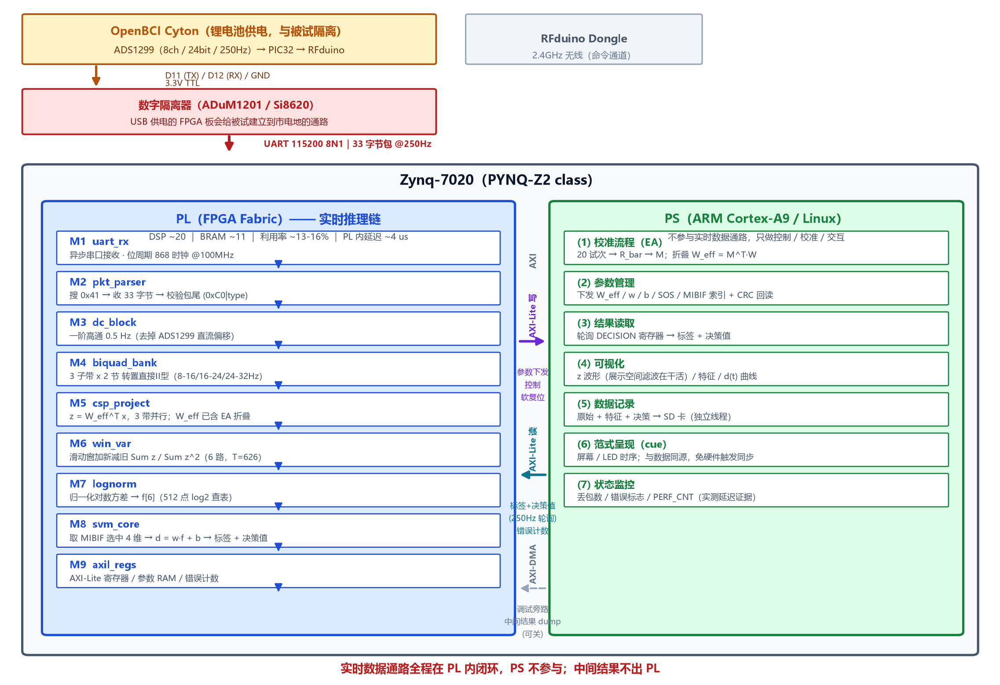
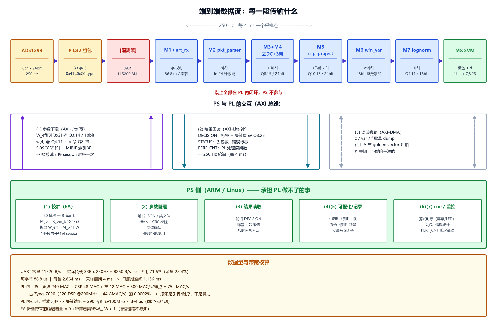

# 08 · 体系结构与数据流

> 上游：[05 算法 FPGA 移植交接文档](05_fpga_porting_handoff.md)（任务分配与寄存器契约）·
> [02 算法实现规格书](02_algorithm_spec.md)（逐级算法）
> 数值以 [07 验证结果与最终配置](07_verification_and_config.md) 为准
> 版本 v1.0

---

## 1. PS / PL 分工与连接



### 1.1 一句话分工

> **PL 承担从引脚到标签的全部实时路径；PS 承担配置、校准、交互。实时通路上 PS 不参与。**

这不是偏好，是三条硬约束推出来的：

| 约束 | 推论 |
|---|---|
| UART 无流控，115200 下占用 71.6% | 接收与解析必须在硬件里，否则丢字节 |
| 项目卖点是"确定性延迟" | PS 的调度抖动不能进入数据通路 |
| 中间结果出 PL 就要过 DMA | 往返一次就多一层抖动与 bug 面 |

### 1.2 PL 侧模块

| # | 模块 | 职责 | 关键参数 |
|---|---|---|---|
| M1 | `uart_rx` | 异步串口接收 | 位周期 868 时钟 @100 MHz（误差 +0.006%） |
| M2 | `pkt_parser` | 搜 `0x41` → 收 33 字节 → 校验包尾 | 超时 174 µs 失步恢复；**0 DSP / 0 BRAM** |
| M3 | `dc_block` | 一阶高通去直流 | a = 0.9876 @ Q1.15 |
| M4 | `biquad_bank` | 3 子带 × 2 节 带通 | 转置直接 II 型；240 MAC/采样点 |
| M5 | `csp_project` | `z = W_eff^T·x`，3 带并行 | **W_eff 已含 EA 折叠**；Q3.14 / 18 bit |
| M6 | `win_var` | 滑动窗加新减旧 Σz / Σz² | 6 路，T=626；全整数 → 零漂移 |
| M7 | `lognorm` | 归一化对数方差 | 512 点 log2 查表 + 线性插值 |
| M8 | `svm_core` | 取 MIBIF 选中 4 维 → 判决 | 折叠后 4 权重 + 1 偏置 |
| M9 | `axil_regs` | AXI-Lite 寄存器 / 参数 RAM / 错误计数 | 见 05 号文档 §4.1 |

**资源**：DSP ~20 ｜ BRAM ~11 ｜ LUT ~6K ｜ 利用率 ~13–16% ｜ PL 内延迟 ~4 µs

### 1.3 PS 侧职责

| # | 职责 | 为什么必须在 PS |
|---|---|---|
| (1) | **校准（EA）** | 需要矩阵开方 $M=\bar R^{-1/2}$，PL 做特征分解不划算 |
| (2) | 参数管理 | 解析 JSON、CRC 校验、回读确认——控制流 |
| (3) | 结果读取 | 轮询寄存器、加时间戳、入队 |
| (4) | 可视化 | 需要 OS 与图形库 |
| (5) | 数据记录 | 需要文件系统 |
| (6) | 范式呈现（cue） | 屏幕/LED 时序；**与数据同源，免硬件触发同步** |
| (7) | 状态监控 | 丢包数、错误标志、`PERF_CNT` |

> **注意 (1) 的分量**：它不是"打杂"，是本项目唯一需要矩阵分解的环节，
> 而且实测带来 **+2.94 pp** 的精度增益——是 PS 承担的最有价值的工作。

### 1.4 PL ↔ PS 的三个接口

| 接口 | 方向 | 内容 | 频率 |
|---|---|---|---|
| **AXI-Lite 写** | PS → PL | 参数下发、控制、软复位 | 换被试/换 session 各一次 |
| **AXI-Lite 读** | PL → PS | 标签 + 决策值、状态、错误计数 | **250 Hz 轮询**（每 4 ms） |
| **AXI-DMA**（旁路） | PL → PS | `z` / `var` / `f` 批量 dump | 仅调试，**可关，不影响主通路** |

**为什么不用中断**：250 Hz 下中断的上下文切换开销与抖动都不划算。轮询一个寄存器
在 Cortex-A9 上是几十个周期的事。只有将来做在线自适应时才需要「协方差累加完成」中断。

---

## 2. 端到端数据流



### 2.1 逐段数据规格

| 段 | 数据 | 格式 | 速率 / 量 |
|---|---|---|---|
| ADS1299 → PIC32 | 8 通道原始采样 | int24 | 250 Hz |
| PIC32 → UART | 33 字节包 | `0x41` … `0xC0\|type` | 8250 B/s |
| UART → M1 | 字节流 | 8N1 @115200 | 86.8 µs/字节 |
| M1 → M2 | 字节 + valid | 8 bit | 同上 |
| M2 → M3 | `x[8]` | int24，计数域 | 250 Hz |
| M3 → M4 | `x'` | Q8.15 / 24 bit | 250 Hz |
| M4 → M5 | `x_b[3]` | Q8.15 / 24 bit，3 带并行 | 250 Hz × 3 |
| M5 → M6 | `z[3带 × 2]` | Q10.13 / 24 bit | 250 Hz × 6 |
| M6 → M7 | `var[6]` | 48 bit 整数累加 | 250 Hz |
| M7 → M8 | `f[6]` → 选 4 维 | Q4.11 / 16 bit | 250 Hz |
| M8 → 输出 | 标签 + 决策值 | 1 bit + Q8.23 | 250 Hz |

### 2.2 PS ↔ PL 传什么

| 方向 | 内容 | 定点格式 | 时机 |
|---|---|---|---|
| **PS → PL** | `W_eff[3][3×2]` | **Q3.14 / 18 bit** | 换被试 / 换 session |
| | `w[4]` | Q4.11 / 16 bit | 同上 |
| | `b` | Q8.23 / 32 bit | 同上 |
| | `SOS[3][2][5]` | Q3.14 / 18 bit | 同上 |
| | `MIBIF 索引[4]` | uint8 | 同上 |
| | 特征标准化 `mu` / `sd` | Q4.11 | 同上 |
| **PL → PS** | `DECISION`：标签 + 决策值 | 1 bit + Q8.23 | **250 Hz 轮询** |
| | `STATUS`：丢包数 / 错误标志 | — | 按需 |
| | `PERF_CNT`：PL 处理周期数 | uint32 | 按需（延迟证据） |
| **PL → PS（旁路）** | `z` / `var` / `f` 批量 | 各路原生格式 | 调试时 |

> ⚠️ **`W_eff` 是 18 bit 而不是 16 bit** —— EA 折叠让权重动态范围从 <2.0 涨到 3.81，
> Q2.14 / 16 bit 会溢出。详见 [07 号文档 §4.2](07_verification_and_config.md)。

### 2.3 带宽与延迟核算

| 项 | 值 |
|---|---|
| UART 容量 | 11520 B/s |
| 实际负载 | 8250 B/s → **占用 71.6%**（余量 28.4%） |
| 每字节 / 每包 | 86.8 µs / 2.864 ms |
| 采样周期 / 空闲 | 4 ms / **1.136 ms** |
| PL 内计算量 | 300 MAC/采样点 = 75 kMAC/s |
| 占 7020 算力比 | **0.0002%** |
| **PL 内延迟** | **~290 周期 ≈ 3–4 µs**（确定·无抖动） |
| EA 带来的延迟增量 | **0**（矩阵已离线乘进 `W_eff`） |

> **瓶颈是引脚与时序，不是算力。** 75 kMAC/s vs 44 GMAC/s 的峰值——所以本项目的卖点
> 不能讲"加速"，要讲**确定性延迟、通道可扩展、低功耗**。

---

## 3. 三条设计原则

| # | 原则 | 理由 |
|---|---|---|
| **P1** | **实时通路全程在 PL 内闭环，中间结果不出 PL** | 出一次就要过 DMA，多一层抖动 + 一层 bug 面 |
| **P2** | **可折叠的算子一律折进已有参数矩阵** | EA 白化折进 CSP 后，PL 零改动就拿到 +2.94 pp |
| **P3** | **PS 只做 PL 做不了的事**（矩阵分解、OS、文件系统） | 否则就是把 PS 当搬运工，还会引入抖动 |

**P2 是本项目最值钱的一条。** 精度提升里最大的一项（EA）恰好是零硬件代价的。

---

## 4. 复现

```powershell
.venv\Scripts\python.exe python\make_block_diagrams.py
# 输出 → report/design/figures/fig_d1_partition.png
#       report/design/figures/fig_d2_dataflow.png
```

*图中所有数字来自 [07 号文档](07_verification_and_config.md) 与 `params/csp_svm_params.json`。*
